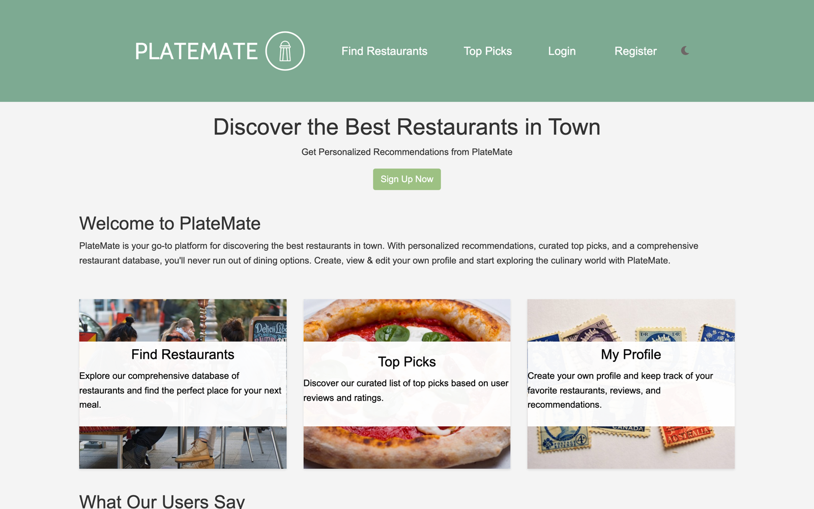
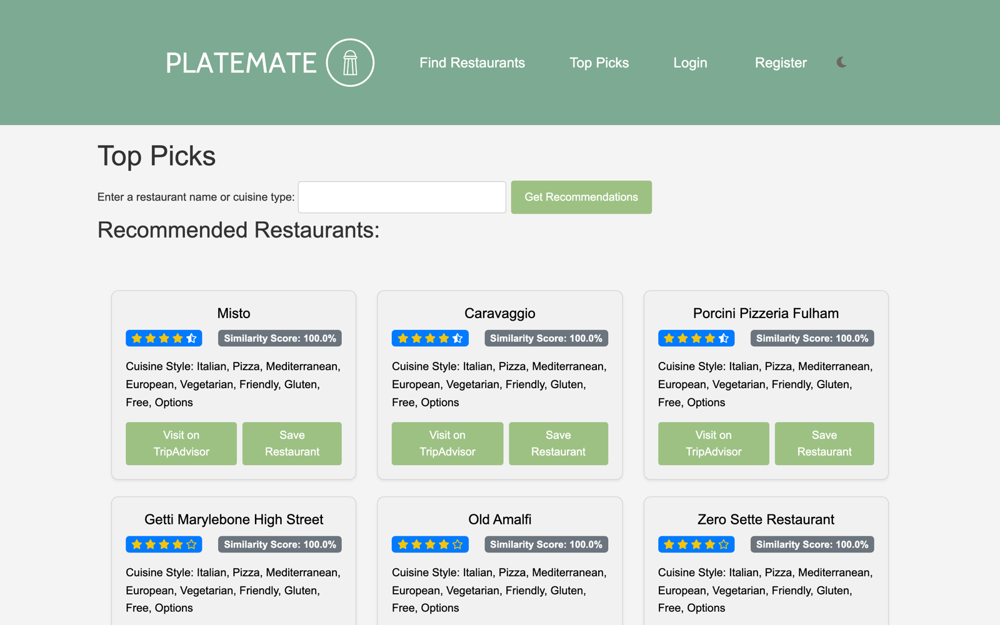
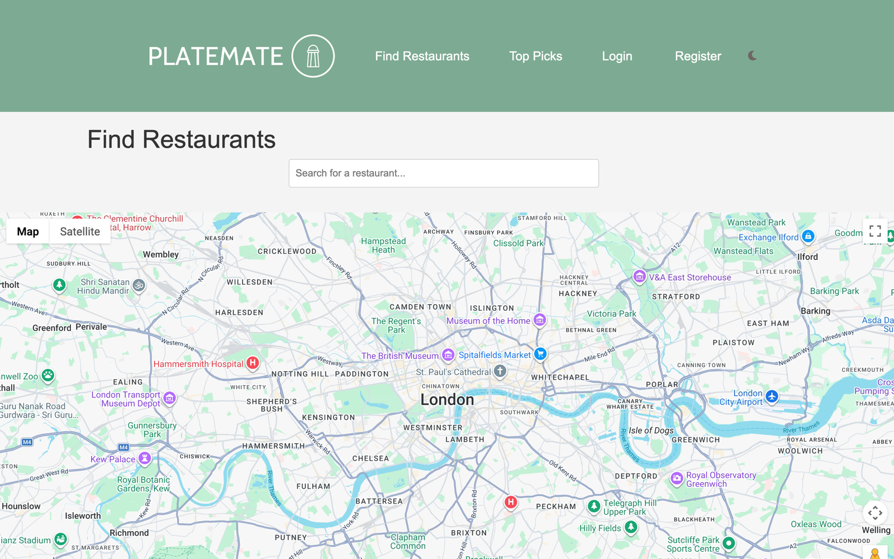

<div align="center">


**A personalised restaurant recommendation engine for London.**


[Portfolio](https://www.yousef.studio/)

</div>



## About

PlateMate was my final-year project at the University of Westminster (2023). Name a restaurant you love, or a cuisine, and
it recommends places across London that are genuinely similar. It doesn't just sort by star rating.

## How the recommendations work

1. **Data:** around 18,000 London restaurants from TripAdvisor (`london_TA_data.csv`), cleaned with `scraper.py`.
2. **Features:** cuisine styles are multi-hot encoded with `MultiLabelBinarizer`, and ranking, rating and price range are
   scaled with `MinMaxScaler`.
3. **Weighting:** the features are combined into one weighted matrix. Cuisine counts ×3, price ×2, and rating and ranking ×1,
   so "feels like the same kind of place" matters most.
4. **Similarity:** a **cosine similarity** matrix compares every restaurant with every other one.
5. **Search:** fuzzy matching (`fuzzywuzzy`) forgives typos in restaurant names. If no restaurant matches, PlateMate treats the
   search as a cuisine and returns the best-rated places for it.
6. **Results:** the nine closest restaurants, each with a similarity score, star rating, cuisine tags and a link to TripAdvisor.



## Features

- **Top Picks:** personalised recommendations with a similarity percentage
- **Find Restaurants:** search London restaurants on an interactive map
- **Accounts:** register, log in, reset your password, edit your profile and delete your account (Firebase Authentication)
- **Save restaurants** to your profile
- Light and dark mode



## Project structure

```
app.py               Flask app: routes, auth and the recommendation engine
similaritymatrix.py  builds the feature matrix and cosine similarities
scraper.py           cleans and enriches the TripAdvisor data
platemate.py         data exploration and merging
templates/           Jinja pages (home, top picks, find restaurants, profile, auth)
static/              CSS, JavaScript and images
*.csv                restaurant datasets
```

## Run it

```bash
pip install -r requirements.txt
export FIREBASE_CREDENTIALS=/path/to/your-firebase-adminsdk.json   # Firebase Console → Service accounts
export FIREBASE_API_KEY=...       # Firebase Console → Project settings → your web app
export FIREBASE_APP_ID=...
export FIREBASE_SENDER_ID=...
python app.py
```

Then open http://localhost:5000. No keys are stored in this repo. They are all read from environment variables.
